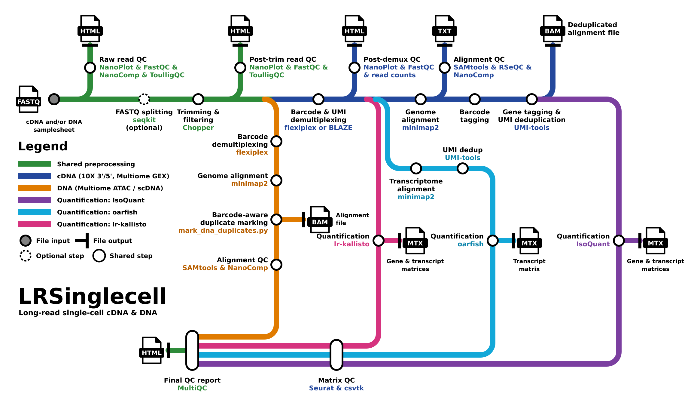

# LRSinglecell

[](https://github.com/IntGenomicsLab/lrsinglecell/actions/workflows/nf-test.yml)
[](https://github.com/IntGenomicsLab/lrsinglecell/actions/workflows/linting.yml)
[](https://www.nf-test.com)

[](https://www.nextflow.io/)
[](https://github.com/nf-core/tools/releases/tag/4.2.1)
[](https://docs.conda.io/en/latest/)
[](https://www.docker.com/)
[](https://sylabs.io/docs/)
[](https://doi.org/10.5281/zenodo.24341090)

## Introduction

**LRSinglecell** (`IntGenomicsLab/lrsinglecell`) is a bioinformatics pipeline for single-cell/nuclei long-read sequencing data from Oxford Nanopore. It processes 10X Genomics cDNA libraries (gene and isoform quantification) and single-cell DNA libraries, either separately or together in one run (e.g. 10X Multiome), from raw FASTQ to cell-barcode-tagged, deduplicated BAMs, feature-barcode matrices and QC reports.

LRSinglecell is derived from [nf-core/scnanoseq](https://github.com/nf-core/scnanoseq) v1.3.0 and extends it with DNA support, flexiplex demultiplexing, gene-aware UMI deduplication and an lr-kallisto quantifier. See the [CHANGELOG](CHANGELOG.md) for everything that differs from nf-core/scnanoseq.

> [!NOTE]
> **LRSinglecell replaces our earlier [scdnalong](https://github.com/IntGenomicsLab/scdnalong) pipeline, which is retired and no longer maintained.** Everything scdnalong was meant to do (single-cell long-read DNA) is in LRSinglecell, together with the cDNA arm. LRSinglecell is a separate pipeline and not part of nf-core; it shares code with nf-core/scnanoseq but is developed independently.

The pipeline is built using [Nextflow](https://www.nextflow.io) and the [nf-core](https://nf-co.re) template, with one container per process for reproducibility.

## Pipeline summary



1. Raw read QC ([`NanoPlot`](https://github.com/wdecoster/NanoPlot), optionally [`FastQC`](https://www.bioinformatics.babraham.ac.uk/projects/fastqc/), [`NanoComp`](https://github.com/wdecoster/nanocomp) and [`ToulligQC`](https://github.com/GenomiqueENS/toulligQC))
2. Optional FASTQ splitting for parallelisation ([`seqkit`](https://bioinf.shenwei.me/seqkit/))
3. Read trimming and filtering ([`Chopper`](https://github.com/wdecoster/chopper))
4. Barcode and UMI demultiplexing, per data type:
   - cDNA: [`flexiplex`](https://github.com/DavidsonGroup/flexiplex) (default) or [`BLAZE`](https://github.com/shimlab/BLAZE) with barcode correction
   - DNA: [`flexiplex`](https://github.com/DavidsonGroup/flexiplex)
5. cDNA:
   1. Alignment to the genome and/or transcriptome ([`minimap2`](https://github.com/lh3/minimap2)) and alignment QC ([`SAMtools`](http://www.htslib.org/doc/samtools.html), [`RSeQC`](https://rseqc.sourceforge.net/))
   2. Gene tagging and gene/transcript-aware UMI deduplication ([`UMI-tools`](https://github.com/CGATOxford/UMI-tools))
   3. Quantification with any combination of [`IsoQuant`](https://github.com/ablab/IsoQuant) (gene + transcript), [`oarfish`](https://github.com/COMBINE-lab/oarfish) (transcript) and [`lr-kallisto`](https://github.com/pachterlab/kallisto) (gene + transcript, alignment-free), for called cells and, optionally, all droplets
   4. Preliminary matrix QC ([`Seurat`](https://github.com/satijalab/seurat))
6. DNA:
   1. Alignment to the genome ([`minimap2`](https://github.com/lh3/minimap2))
   2. Barcode-aware fragment duplicate marking (`bin/mark_dna_duplicates.py`)
   3. Alignment QC ([`SAMtools`](http://www.htslib.org/doc/samtools.html))
7. QC report for raw and processed reads, alignment, deduplication and matrices ([`MultiQC`](http://multiqc.info/))

## Usage

> [!NOTE]
> If you are new to Nextflow and nf-core, please refer to [this page](https://nf-co.re/docs/get_started/environment_setup/overview) on how to set-up Nextflow. A step-by-step walkthrough from installation to loading the results in R is in the **[tutorial](docs/tutorial.md)**.

### Quick test

All you need is Nextflow (≥ 25.10.4) and Docker, Singularity/Apptainer or Conda. The bundled test profiles download small public datasets against a chr21 reference and finish in minutes. `test_mixed` uses a subsample of one 10X Multiome cell line (cDNA + DNA):

```bash
nextflow run IntGenomicsLab/lrsinglecell -r v1.1.0 -profile test_mixed,singularity --outdir test_results
```

Use `test` for cDNA only (two 10X 3' v3 samples), `test_dna` for DNA only (the DNA half of the Multiome subsample), or `test_mixed` for both; `test_lrkallisto` and `test_oarfish` run the `test` data through lr-kallisto and through IsoQuant + oarfish (without a transcript FASTA). All profiles are described in the [usage documentation](docs/usage.md#-profile). Replace `singularity` with `docker`, `apptainer` or `conda` to match your system.

### Samplesheet

Prepare a comma-separated samplesheet with a header row and one row per FASTQ file:

```csv title="samplesheet.csv"
sample,fastq,cell_count,type
CONTROL_REP1,/data/AEG588A1_cDNA_run1.fastq.gz,5000,cdna
CONTROL_REP1,/data/AEG588A1_cDNA_run2.fastq.gz,5000,cdna
CONTROL_REP1,/data/AEG588A1_DNA.fastq.gz,5000,dna
```

| Column       | Required | Description                                                                                                                         |
| ------------ | -------- | ----------------------------------------------------------------------------------------------------------------------------------- |
| `sample`     | yes      | Sample name, no spaces. Rows with the same `sample` and `type` are concatenated before processing (e.g. several runs of a library). |
| `fastq`      | yes      | Path or URL to a gzipped single-end ONT FASTQ (`.fastq.gz` / `.fq.gz`). The cDNA and DNA libraries are separate files.              |
| `cell_count` | yes      | Expected number of cells/nuclei (integer > 0). Used by BLAZE as `--expect-cells`; required but unused on DNA rows.                  |
| `type`       | no       | `cdna` (default) or `dna`; selects the processing arm.                                                                              |

A ready-made example (two 10X Multiome samples, one with its cDNA library sequenced twice) is in [`assets/samplesheet.csv`](assets/samplesheet.csv); the samplesheets used by the test profiles are in [IntGenomicsLab/test-datasets](https://github.com/IntGenomicsLab/test-datasets/tree/main/lrsinglecell/samplesheet).

### Running

cDNA only (e.g. 10X 3' v3):

```bash
nextflow run IntGenomicsLab/lrsinglecell -r v1.1.0 \
   -profile <docker/singularity/.../institute> \
   --input samplesheet.csv \
   --genome_fasta genome.fa \
   --gtf genes.gtf \
   --barcode_format 10X_3v3 \
   --quantifier isoquant \
   --outdir <OUTDIR>
```

DNA, or DNA + cDNA together (10X Multiome):

```bash
nextflow run IntGenomicsLab/lrsinglecell -r v1.1.0 \
   -profile <docker/singularity/.../institute> \
   --input samplesheet.csv \
   --genome_fasta genome.fa \
   --gtf genes.gtf \
   --barcode_format 10X_multiome \
   --quantifier isoquant \
   --outdir <OUTDIR>
```

`--quantifier` (`isoquant`, `oarfish`, `lrkallisto`, comma-separated) is only required when the samplesheet contains cDNA samples. DNA samples need `--genome_fasta` and a known barcode layout: `--barcode_format 10X_multiome`, or a custom flexiplex pattern given with `--custom_flexiplex_barcode_dna` together with `--dna_whitelist` (see [DNA libraries](docs/usage.md#dna-libraries)).

> [!WARNING]
> Please provide pipeline parameters via the CLI or Nextflow `-params-file` option. Custom config files including those provided by the `-c` Nextflow option can be used to provide any configuration _**except for parameters**_; see [docs](https://nf-co.re/docs/running/run-pipelines#using-parameter-files).

For a full walkthrough see the [tutorial](docs/tutorial.md); for more details and further functionality, please refer to the [usage documentation](docs/usage.md) and the [parameter schema](nextflow_schema.json).

## Pipeline output

The main outputs are, per sample and data type, deduplicated BAMs and (for cDNA) gene- and transcript-level feature-barcode matrices that can be read directly by `Seurat` and similar packages, together with QC metrics and a MultiQC report. For details about the output files and reports, please refer to the [output documentation](docs/output.md).

## Troubleshooting

Solutions to common problems (long run times and `--split_amount`, resources for large PromethION runs, `--fasta_delimiter`, BLAZE-specific settings) are in the [troubleshooting section of the usage documentation](docs/usage.md#troubleshooting). If that does not help, please [open an issue](https://github.com/IntGenomicsLab/lrsinglecell/issues/new/choose).

## Credits

LRSinglecell is written and maintained by [Luuk Harbers](https://github.com/ljwharbers) at the [Integrative Cancer Genomics Lab](https://github.com/IntGenomicsLab) (VIB-KU Leuven Center for Cancer Biology).

It is derived from [nf-core/scnanoseq](https://github.com/nf-core/scnanoseq), originally written by [Austyn Trull](https://github.com/atrull314) and [Dr. Lara Ianov](https://github.com/lianov) at the University of Alabama at Birmingham Biological Data Science Core (U-BDS). We thank them and the nf-core/scnanoseq contributors for the foundation this pipeline builds on.

The test data lives in [IntGenomicsLab/test-datasets](https://github.com/IntGenomicsLab/test-datasets/tree/main/lrsinglecell) and is copied from the nf-core/scnanoseq test data in [nf-core/test-datasets](https://github.com/nf-core/test-datasets/tree/scnanoseq) (MIT).

## Contributions and Support

If you would like to contribute to this pipeline, please see the [contributing guidelines](docs/CONTRIBUTING.md).

## Citing LRSinglecell

If you use LRSinglecell for your analysis, please cite:

> **Long-read single-cell genome, transcriptome and open chromatin profiling links genotype to phenotypes**
>
> Alexandra Pančíková, Ruben Cools, Marios Eftychiou, Margo Aertgeerts, Joris Vande Velde, Heidi Segers, Jan Cools, Luuk Harbers, Jonas Demeulemeester
>
> _bioRxiv_ 2025. doi: [10.1101/2025.09.08.674950](https://doi.org/10.1101/2025.09.08.674950)

and the version of the pipeline you used, archived on Zenodo: [10.5281/zenodo.24341090](https://doi.org/10.5281/zenodo.24341090) (this concept DOI always resolves to the latest release; each release has its own version DOI on the Zenodo record, e.g. [10.5281/zenodo.24341091](https://doi.org/10.5281/zenodo.24341091) for v1.1.0).

Please also cite nf-core/scnanoseq, on which LRSinglecell is based:

> **scnanoseq: an nf-core pipeline for Oxford Nanopore single-cell RNA-sequencing**
>
> Austyn Trull, Elizabeth A. Worthey, Lara Ianov
>
> Bioinformatics, Volume 41, Issue 9, September 2025, btaf487, <https://doi.org/10.1093/bioinformatics/btaf487>

An extensive list of references for the tools used by the pipeline can be found in the [`CITATIONS.md`](CITATIONS.md) file.

This pipeline uses code and infrastructure developed and maintained by the [nf-core](https://nf-co.re) community, reused here under the [MIT license](https://github.com/nf-core/tools/blob/main/LICENSE).

> **The nf-core framework for community-curated bioinformatics pipelines.**
>
> Philip Ewels, Alexander Peltzer, Sven Fillinger, Harshil Patel, Johannes Alneberg, Andreas Wilm, Maxime Ulysse Garcia, Paolo Di Tommaso & Sven Nahnsen.
>
> _Nat Biotechnol._ 2020 Feb 13. doi: [10.1038/s41587-020-0439-x](https://dx.doi.org/10.1038/s41587-020-0439-x)

> **Empowering bioinformatics communities with Nextflow and nf-core.**
>
> Langer, B.E., Amaral, A., Baudement, MO. et al.
>
> _Genome Biol_ 2025 July 29. doi [10.1186/s13059-025-03673-9](https://doi.org/10.1186/s13059-025-03673-9)
