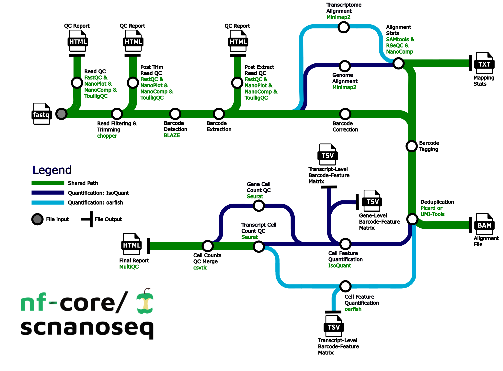

# LRSinglecell

[](https://github.com/IntGenomicsLab/lrsinglecell/actions/workflows/nf-test.yml)
[](https://github.com/IntGenomicsLab/lrsinglecell/actions/workflows/linting.yml)
[](https://www.nf-test.com)

[](https://www.nextflow.io/)
[](https://github.com/nf-core/tools/releases/tag/4.1.0)
[](https://docs.conda.io/en/latest/)
[](https://www.docker.com/)
[](https://sylabs.io/docs/)

## Introduction

**LRSinglecell** (`IntGenomicsLab/lrsinglecell`) is a bioinformatics pipeline for single-cell/nuclei long-read sequencing data from Oxford Nanopore. It processes 10X Genomics cDNA libraries (gene and isoform quantification) and single-cell DNA libraries, either separately or together in one run (e.g. 10X Multiome), from raw FASTQ to deduplicated per-cell BAMs, feature-barcode matrices and QC reports.

LRSinglecell is derived from [nf-core/scnanoseq](https://github.com/nf-core/scnanoseq) v1.3.0 and extends it with DNA support, flexiplex demultiplexing, gene-aware UMI deduplication and an lr-kallisto quantifier. See the [CHANGELOG](CHANGELOG.md) for everything that differs from nf-core/scnanoseq.

The pipeline is built using [Nextflow](https://www.nextflow.io) and the [nf-core](https://nf-co.re) template, with one container per process for reproducibility.

## Pipeline summary



1. Raw read QC ([`NanoPlot`](https://github.com/wdecoster/NanoPlot), optionally [`FastQC`](https://www.bioinformatics.babraham.ac.uk/projects/fastqc/), [`NanoComp`](https://github.com/wdecoster/nanocomp) and [`ToulligQC`](https://github.com/GenomiqueENS/toulligQC))
2. Optional FASTQ splitting for parallelisation ([`seqkit`](https://bioinf.shenwei.me/seqkit/))
3. Read trimming and filtering ([`Chopper`](https://github.com/wdecoster/chopper))
4. Barcode and UMI demultiplexing, per data type:
   - cDNA: [`flexiplex`](https://github.com/DavidsonGroup/flexiplex) (default) or [`BLAZE`](https://github.com/shimlab/BLAZE) with barcode correction
   - DNA: [`flexiplex`](https://github.com/DavidsonGroup/flexiplex)
5. cDNA:
   1. Alignment to the genome and/or transcriptome ([`minimap2`](https://github.com/lh3/minimap2)) and alignment QC ([`SAMtools`](http://www.htslib.org/doc/samtools.html), [`RSeQC`](https://rseqc.sourceforge.net/))
   2. Gene tagging and gene/transcript-aware UMI deduplication ([`UMI-tools`](https://github.com/CGATOxford/UMI-tools))
   3. Quantification with any combination of [`IsoQuant`](https://github.com/ablab/IsoQuant) (gene + transcript), [`oarfish`](https://github.com/COMBINE-lab/oarfish) (transcript) and [`lr-kallisto`](https://github.com/pachterlab/kallisto) (gene + transcript, alignment-free), for called cells and, optionally, all droplets
   4. Preliminary matrix QC ([`Seurat`](https://github.com/satijalab/seurat))
6. DNA:
   1. Alignment to the genome ([`minimap2`](https://github.com/lh3/minimap2))
   2. Barcode-aware fragment duplicate marking (`bin/mark_dna_duplicates.py`)
   3. Alignment QC ([`SAMtools`](http://www.htslib.org/doc/samtools.html))
7. QC report for raw and processed reads, alignment, deduplication and matrices ([`MultiQC`](http://multiqc.info/))

## Usage

> [!NOTE]
> If you are new to Nextflow and nf-core, please refer to [this page](https://nf-co.re/docs/get_started/environment_setup/overview) on how to set-up Nextflow. Make sure to test your setup with `-profile test` (cDNA), `-profile test_dna` (DNA) or `-profile test_mixed` (both) before running the workflow on actual data.

First, prepare a samplesheet with your input data that looks as follows:

```csv title="samplesheet.csv"
sample,fastq,cell_count,type
CONTROL_REP1,AEG588A1_S1.fastq.gz,5000,cdna
CONTROL_REP1,AEG588A1_S2.fastq.gz,5000,cdna
CONTROL_REP1,AEG588A1_DNA.fastq.gz,5000,dna
```

Each row represents a single-end FASTQ file. Rows with the same `sample` and `type` are merged before processing. `cell_count` is the expected number of cells, and `type` (`cdna` or `dna`, default `cdna`) selects the processing arm.

Now, you can run the pipeline using:

```bash
nextflow run IntGenomicsLab/lrsinglecell \
   -profile <docker/singularity/.../institute> \
   --input samplesheet.csv \
   --genome_fasta genome.fa \
   --gtf genes.gtf \
   --barcode_format 10X_3v3 \
   --quantifier isoquant \
   --outdir <OUTDIR>
```

`--quantifier` (`isoquant`, `oarfish`, `lrkallisto`, comma-separated) is only required when the samplesheet contains cDNA samples.

> [!WARNING]
> Please provide pipeline parameters via the CLI or Nextflow `-params-file` option. Custom config files including those provided by the `-c` Nextflow option can be used to provide any configuration _**except for parameters**_; see [docs](https://nf-co.re/docs/running/run-pipelines#using-parameter-files).

For more details and further functionality, please refer to the [usage documentation](docs/usage.md) and the [parameter schema](nextflow_schema.json).

## Pipeline output

The main outputs are, per sample and data type, deduplicated BAMs and (for cDNA) gene- and transcript-level feature-barcode matrices that can be read directly by `Seurat` and similar packages, together with QC metrics and a MultiQC report. For details about the output files and reports, please refer to the [output documentation](docs/output.md).

## Troubleshooting

If you experience any issues, please [open an issue on our GitHub repository](https://github.com/IntGenomicsLab/lrsinglecell/issues/new/choose). However, some resolutions for common issues will be noted below:

- Due to the nature of the data this pipeline analyzes, some tools may experience increased runtimes. For some of the custom tools made for this pipeline (`preextract_fastq.py` and `correct_barcodes.py`), we have leveraged the splitting done via the `split_amount` parameter to decrease their overall runtimes. The `split_amount` parameter will split the input FASTQs into a number of FASTQ files, each containing a number of lines based on the value used for this parameter. As a result, it is important not to set this parameter to be too low as doing so would cause the creation of a large number of files the pipeline will be processed. While this value can be highly dependent on the data, a good starting point for an analysis would be to set this value to `500000`. If you find that `PREEXTRACT_FASTQ` and `CORRECT_BARCODES` are still taking long amounts of time to run, it would be worth reducing this parameter to `200000` or `100000`, but keeping the value on the order of hundred of thousands or tens of thousands should help with keeping the total number of processes minimal. An example of setting this parameter to be equal to 500000 is shown below:

```yml title="params.yml"
split_amount: 500000
```

- We have seen a recurrent node failure on slurm clusters that does seem to be related to submission of Nextflow jobs. This issue is not related to this pipeline per se, but rather to Nextflow itself. We are currently working on a resolution. But we have two methods that appear to help overcome should this issue arise:
  1. Provide a custom config that increases the memory request for the job that failed. This may take a couple attempts to find the correct requests, but we have noted that there does appear to be a memory issue occasionally with these errors.
  2. Request an interactive session with a decent amount of time and memory and CPUs in order to run the pipeline on the single node. Note that this will take time as there will be minimal parallelization, but this does seem to resolve the issue.
- We note that umitools dedup can take a large amount of time in order to perform deduplication. One approach we have implemented to assist with speed is to split input files based on chromosome. However for the transcriptome aligned bams, there is some additional work required that involves grouping transcripts into appropriate chromosomes. In order to accomplish this, the pipeline needs to parse the transcript id from the transcriptome FASTA file. The transcript id is often nested in the sequence identifier with additional data and the data is delimited. We have included the delimiters used by reference files obtained from GENCODE, NCBI, and Ensembl. However in case you wish to explicitly control this or if the reference file source uses a different delimiter, you are able to manually set it via the `--fasta_delimiter` parameter.
- We acknowledge that analyzing PromethION data is a common use case for this pipeline. Currently, the pipeline has been developed with defaults to analyze GridION and average sized PromethION data. For cases, where jobs have fail due for larger PromethION datasets, the defaults can be overwritten by a custom configuation file (provided by the `-c` Nextflow option) where resources can be increased (substantially in some cases). Below are some of the overrides we have used, and while these amounts may not work on every dataset, these will hopefully at least note which processes will need to have their resources increased:

```groovy title="custom.config"

process
{
    withName: '.*:.*FASTQC.*'
    {
        cpus = 20
    }
}

process
{
    withName: '.*:BLAZE'
    {
        cpus = 30
    }
}

process
{
    withName: '.*:TAG_BARCODES'
    {
        memory = '60.GB'
    }
}

process
{
    withName: '.*:SAMTOOLS_SORT'
    {
        cpus = 20
    }
}

process
{
    withName: '.*:MINIMAP2_ALIGN'
    {
        cpus = 20
    }
}

process
{
    withName: '.*:ISOQUANT'
    {
        cpus = 30
        memory = '85.GB'
    }
}
```

We further note that while we encourage the use of `split_amount` as discussed above for larger datasets, the pipeline can be executed without enabling this parameter. When doing this, please consider increasing the time limit to `CORRECT_BARCODES` as it can take hours instead of minutes when `split_amount` is disabled:

```groovy title="custom.config"
//NOTE: with split_amount disabled, consider increasing the time limit to CORRECT_BARCODES
process
{
    withName: '.*:CORRECT_BARCODES'
    {
        time = '15.h'
    }
}
```

## Credits

LRSinglecell is written and maintained by [Luuk Harbers](https://github.com/ljwharbers) at the [Integrative Cancer Genomics Lab](https://github.com/IntGenomicsLab) (VIB-KU Leuven).

It is derived from [nf-core/scnanoseq](https://github.com/nf-core/scnanoseq), originally written by [Austyn Trull](https://github.com/atrull314) and [Dr. Lara Ianov](https://github.com/lianov) at the University of Alabama at Birmingham Biological Data Science Core (U-BDS). We thank them and the nf-core/scnanoseq contributors for the foundation this pipeline builds on.

## Contributions and Support

If you would like to contribute to this pipeline, please see the [contributing guidelines](docs/CONTRIBUTING.md).

## Citations

If you use LRSinglecell for your analysis, please also cite nf-core/scnanoseq, on which it is based:

> **scnanoseq: an nf-core pipeline for Oxford Nanopore single-cell RNA-sequencing**
>
> Austyn Trull, Elizabeth A. Worthey, Lara Ianov
>
> Bioinformatics, Volume 41, Issue 9, September 2025, btaf487, <https://doi.org/10.1093/bioinformatics/btaf487>

An extensive list of references for the tools used by the pipeline can be found in the [`CITATIONS.md`](CITATIONS.md) file.

This pipeline uses code and infrastructure developed and maintained by the [nf-core](https://nf-co.re) community, reused here under the [MIT license](https://github.com/nf-core/tools/blob/main/LICENSE).

> **The nf-core framework for community-curated bioinformatics pipelines.**
>
> Philip Ewels, Alexander Peltzer, Sven Fillinger, Harshil Patel, Johannes Alneberg, Andreas Wilm, Maxime Ulysse Garcia, Paolo Di Tommaso & Sven Nahnsen.
>
> _Nat Biotechnol._ 2020 Feb 13. doi: [10.1038/s41587-020-0439-x](https://dx.doi.org/10.1038/s41587-020-0439-x)

> **Empowering bioinformatics communities with Nextflow and nf-core.**
>
> Langer, B.E., Amaral, A., Baudement, MO. et al.
>
> _Genome Biol_ 2025 July 29. doi [10.1186/s13059-025-03673-9](https://doi.org/10.1186/s13059-025-03673-9)
