# IntGenomicsLab/lrsinglecell: Output

## Introduction

This document describes the files the pipeline publishes to the results directory (`--outdir`). All paths are relative to that directory. Most of the plots are taken from the MultiQC report, which summarises results at the end of the pipeline.

Throughout, `<sample>` is the `sample` column of the samplesheet and `<type>` is its `type` column (`cdna` or `dna`). Per-sample file names usually start with `<sample>.<type>`, e.g. `CONTROL_REP1.cdna.genome.dedup.bam`.

The top level of a results directory looks like this (which directories exist depends on the data types, quantifiers and options used):

```text
<outdir>/
├── <sample>/
│   ├── cdna/                 cDNA arm: barcodes, alignments, deduplication, quantification, QC
│   │   ├── flexiplex/ or blaze/
│   │   ├── genome/           genome alignment (isoquant and lrkallisto runs)
│   │   ├── transcriptome/    transcriptome alignment (oarfish runs)
│   │   ├── lrkallisto/       lr-kallisto matrices (lrkallisto runs)
│   │   ├── lrkallisto_all_droplets/
│   │   └── qc/               read-level QC
│   └── dna/                  DNA arm: barcodes, alignment, duplicate marking, QC
│       ├── flexiplex/
│       ├── bam/
│       └── qc/
├── batch_qcs/                QC across all samples: MultiQC, NanoComp, read counts
├── references/               minimap2 indexes and the lr-kallisto index
└── pipeline_info/            Nextflow reports, software versions, parameters
```

## Pipeline overview

The pipeline is built using [Nextflow](https://www.nextflow.io/) and processes data using the following steps. Sections are tagged with the arm they belong to (**cDNA only**, **DNA only**) and, where it matters, the demultiplexer that produces them (**flexiplex only**, **BLAZE only**); untagged sections apply to both arms.

- [Read QC](#read-qc)
  - [Duplex filter](#duplex-filter) - Dorado duplex parent reads dropped (`--drop_duplex_parents`, off by default)
  - [NanoPlot](#nanoplot) - Long-read FASTQ QC
  - [FastQC](#fastqc) - FASTQ QC (off by default)
  - [ToulligQC](#toulligqc) - Long-read FASTQ QC (off by default)
  - [NanoComp](#nanocomp) - Long-read FASTQ and BAM QC across samples (off by default)
- [Barcode calling](#barcode-calling)
  - [Flexiplex](#flexiplex) - Barcode caller (flexiplex only; the only option for DNA)
  - [BLAZE](#blaze) - Barcode caller (cDNA only, BLAZE only)
- [Alignment](#alignment)
  - [Minimap2](#minimap2) - Long-read alignment and the reusable indexes
- [Alignment post-processing](#alignment-post-processing)
  - [Samtools: cDNA](#samtools-cdna) - Sorted BAMs and alignment statistics (cDNA only)
  - [Samtools: DNA](#samtools-dna) - Alignment statistics of the final DNA BAM (DNA only)
  - [Barcode tags (flexiplex)](#barcode-tags-flexiplex) - The barcode and UMI tags on every alignment (flexiplex only)
  - [Barcode tagging (BLAZE)](#barcode-tagging-blaze) - Barcode-tagged BAMs (cDNA only, BLAZE only)
  - [Gene assignment](#gene-assignment) - Gene tags used for gene-aware deduplication (cDNA only)
  - [UMI-tools dedup](#umi-tools-dedup) - UMI-based read deduplication (cDNA only)
  - [DNA duplicate marking](#dna-duplicate-marking) - Tn5 fragment duplicate marking (DNA only)
- [Feature-barcode quantification](#feature-barcode-quantification) (cDNA only)
  - [IsoQuant](#isoquant) - Gene and transcript matrices from the genome alignment
  - [oarfish](#oarfish) - Transcript matrix from the transcriptome alignment
  - [lr-kallisto](#lr-kallisto) - Gene and transcript matrices by pseudoalignment (flexiplex only)
  - [Seurat](#seurat) - Feature-barcode matrix QC and Seurat objects
- [Summary QC](#summary-qc)
  - [RSeQC](#rseqc) - Read distribution over gene features (cDNA only)
  - [Read counts](#read-counts) - Reads retained at each step
  - [MultiQC](#multiqc) - Aggregate report describing results and QC from the whole pipeline
- [Pipeline information](#pipeline-information) - Report metrics generated during the workflow execution
- [Intermediate files that are not published](#intermediate-files-that-are-not-published)

## Read QC

Read QC runs on the reads at up to three points, each in its own subdirectory:

- `pre_trim/`: the raw reads (after concatenating the FASTQs of one sample and type and, with `--drop_duplex_parents`, dropping the dorado duplex parent reads). File names carry `<sample>.<type>.raw`.
- `post_trim/`: after quality and length filtering with chopper (`--min_q_score`, `--min_length`). File names carry `<sample>.<type>.trimmed`. Not produced with `--skip_trimming`.
- `post_extract/`: after barcode and UMI extraction, i.e. the reads that go into alignment. File names carry `<sample>.<type>.extracted`.

`--skip_qc` turns all of it off.

### Duplex filter

<details markdown="1">
<summary>Output files</summary>

- `<sample>/<type>/qc/duplex_filter/`
  - `<sample>.<type>.duplex_filter.tsv`: number of reads kept and dropped by `--drop_duplex_parents`.

</details>

Only written with `--drop_duplex_parents`, which is off by default; `--skip_qc` does not turn it off. A two-column `metric`/`value` table:

| metric       | meaning                                                                                                                                                                                |
| ------------ | -------------------------------------------------------------------------------------------------------------------------------------------------------------------------------------- |
| `mode`       | `filtered`; `passthrough_no_dx` (no `dx` tags, file used unchanged); `nothing_to_drop` (no `dx:i:-1` reads); `kept_all_no_consensus` (`dx:i:-1` reads but no `dx:i:1` reads, all kept) |
| `records_in` | reads in the input FASTQ                                                                                                                                                               |
| `dx_1`       | duplex consensus reads                                                                                                                                                                 |
| `dx_0`       | simplex reads without a duplex partner                                                                                                                                                 |
| `dx_minus1`  | simplex parents of a duplex consensus read                                                                                                                                             |
| `no_dx_tag`  | reads without a `dx` tag, or with a value other than -1, 0 or 1                                                                                                                        |
| `dropped`    | reads removed; equals `dx_minus1` when `mode` is `filtered`, else 0                                                                                                                    |

For `passthrough_no_dx` the file is not read in full, so the counts are `NA`. In a normal duplex run, `dropped` is about twice `dx_1`. The filter runs before the pre-trim QC, so NanoPlot, FastQC, ToulligQC, NanoComp and the read counts all describe the filtered reads. See the [usage docs](usage.md#dorado-duplex-reads) for the input requirements.

### NanoPlot

<details markdown="1">
<summary>Output files</summary>

- `<sample>/<type>/qc/nanoplot/`
  - `pre_trim/`, `post_trim/`, `post_extract/`
    - `<sample>.<type>.{raw,trimmed,extracted}_NanoPlot-report.html`: Browser-viewable report with all figures in one place.
    - `<sample>.<type>.{raw,trimmed,extracted}_NanoStats.txt`: Summary statistics of the reads (read count, yield, length and quality distributions).
    - `<sample>.<type>.{raw,trimmed,extracted}_*.html`: The individual figures of the report (length histograms, length vs quality scatter plots, yield by length).

</details>

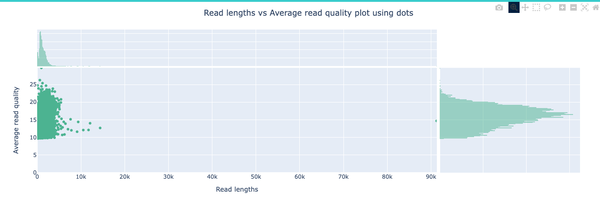
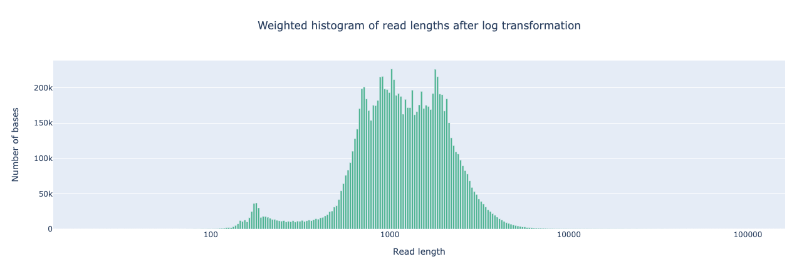

[NanoPlot](https://github.com/wdecoster/NanoPlot) is a plotting tool for long-read sequencing data and alignments. It runs by default and can be turned off with `--skip_nanoplot`.

### FastQC

<details markdown="1">
<summary>Output files</summary>

- `<sample>/<type>/qc/fastqc/`
  - `pre_trim/`, `post_trim/`, `post_extract/`
    - `*_fastqc.html`: FastQC report containing quality metrics.
    - `*_fastqc.zip`: Zip archive containing the FastQC report, tab-delimited data file and plot images.

</details>

[FastQC](http://www.bioinformatics.babraham.ac.uk/projects/fastqc/) gives general quality metrics about your sequenced reads. It provides information about the quality score distribution across your reads, per base sequence content (%A/T/G/C), adapter contamination and overrepresented sequences. For further reading and documentation see the [FastQC help pages](http://www.bioinformatics.babraham.ac.uk/projects/fastqc/Help/).

FastQC is **off by default** (`--skip_fastqc true`); set `--skip_fastqc=false` to run it.

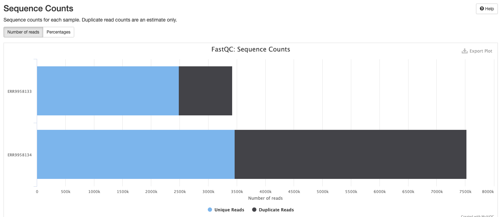

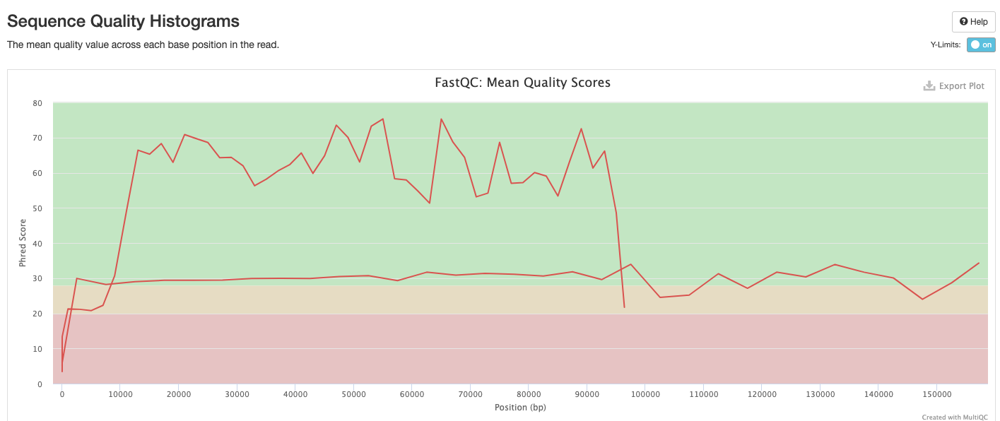

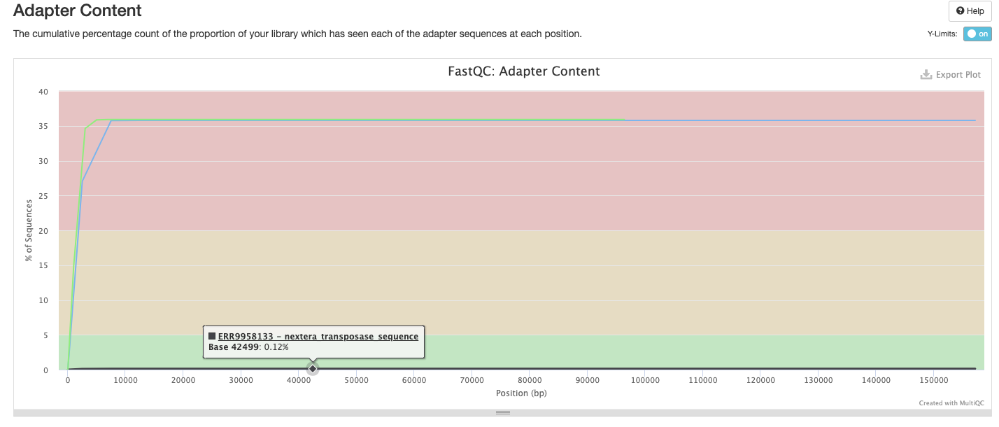

:::note
The raw-read FastQC results are shown in the raw-QC MultiQC report (`batch_qcs/multiqc/raw_qc/`), which is only produced when FASTQ NanoComp and NanoPlot run as well (see [MultiQC](#multiqc)); the post-trim and post-extract results are shown in the final report.
:::

### ToulligQC

<details markdown="1">
<summary>Output files</summary>

- `<sample>/<type>/qc/toulligqc/`
  - `pre_trim/`, `post_trim/`, `post_extract/`
    - `<sample>.<type>.{raw,trimmed,extracted}_/`
      - `report.html`: Browser-viewable report with all figures in one place.
      - `report.data`: Information about the ToulligQC run, its environment and the full statistics.
      - `images/`: The individual figures of the report, as HTML.

</details>

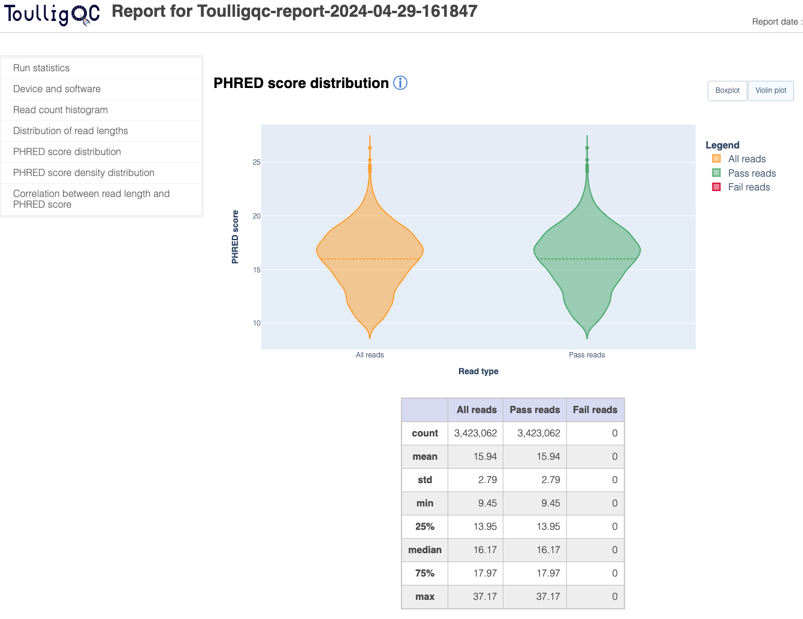
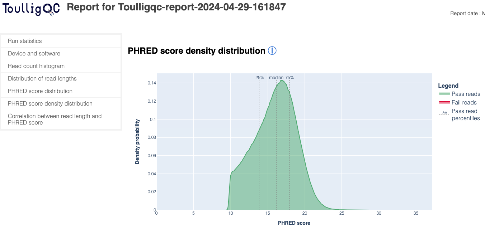

[ToulligQC](https://github.com/GenomiqueENS/toulligQC) is a post-sequencing QC tool for Oxford Nanopore sequencers. It is **off by default** (`--skip_toulligqc true`); set `--skip_toulligqc=false` to run it.

### NanoComp

<details markdown="1">
<summary>Output files</summary>

- `batch_qcs/nanocomp/`
  - `fastq/cdna/`, `fastq/dna/`: Raw reads of all samples of one type, compared.
    - `{cdna,dna}_NanoComp-report.html`: Browser-viewable report with all figures in one place.
    - `{cdna,dna}_NanoStats.txt`: Summary statistics per sample.
    - `{cdna,dna}_NanoComp_*.html`: The individual figures of the report.
  - `bam/cdna/genome/`: The same for the cDNA genome alignments (`genome_` prefix).
  - `bam/dna/`: The same for the DNA alignments (`dna_` prefix).

</details>

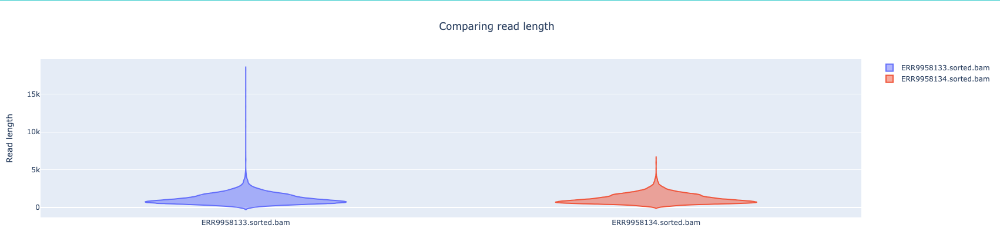
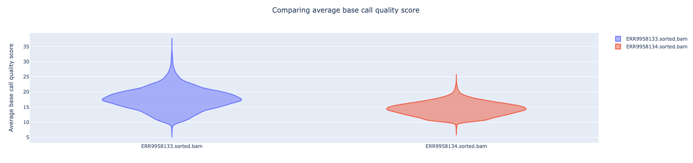

[NanoComp](https://github.com/wdecoster/nanocomp) compares multiple runs of long-read sequencing data and alignments. It creates violin plots or box plots of length, quality and percent identity and creates dynamic, overlaying read length histograms and a cumulative yield plot.

**Note**: NanoComp is **off by default** for both FASTQ files (`--skip_fastq_nanocomp true`) and BAM files (`--skip_bam_nanocomp true`), because of its memory use on BAMs. Set `--skip_fastq_nanocomp=false` and/or `--skip_bam_nanocomp=false` to run it. NanoComp is never run on the cDNA transcriptome alignment.

## Barcode calling

### Flexiplex

_Flexiplex only. Used for every DNA sample, and for cDNA samples with `--demux_tool_cdna flexiplex` (the default)._

<details markdown="1">
<summary>Output files</summary>

- `<sample>/<type>/flexiplex/`
  - `<sample>_barcodes_counts.txt`: Every barcode flexiplex found in the reads, with the number of reads that support it (discovery mode, before any whitelist filtering).
  - `<sample>_barcode_counts.txt`: Instead of the file above when `--split_amount` > 0: the per-chunk barcode counts summed over all chunks.
  - `<sample>.<type>_known_barcodes.txt`: The called cells: the barcodes that `flexiplex-filter` kept after matching against the whitelist and calling the knee, with their read counts. These are the barcodes that end up in `CB`.

</details>

[Flexiplex](https://github.com/DavidsonGroup/flexiplex/) is a fast, multithreaded, and user-configurable demultiplexer. Given a set of reads as either FASTQ or FASTA, it will demultiplex and/or identify a sequence of interest, reporting matching reads and read-barcode assignment. Flexiplex works in two modes: (i) when one or more sequences of interest are known, such as barcodes, and (ii) discovery mode, when only the sequence which flanks the region of interest is known.

The pipeline first runs flexiplex in discovery mode to count every barcode, then `flexiplex-filter` calls the cells against the whitelist (`--cdna_whitelist`/`--dna_whitelist`, or the whitelist bundled for `--barcode_format`), and finally flexiplex assigns every read to a barcode. The assigned reads themselves are not published; they go straight into alignment.

### BLAZE

_cDNA only, BLAZE only (`--demux_tool_cdna blaze`)._

<details markdown="1">
<summary>Output files</summary>

- `<sample>/cdna/blaze/`
  - `<sample>.bc_count.txt`: Each putative barcode and the number of reads that support it.
  - `<sample>.knee_plot.png`: The knee plot, ranking each barcode by read count.
  - `<sample>.putative_bc.no_header.csv`: The barcode, UMI and quality BLAZE detected for each read, before whitelist correction.
  - `<sample>.whitelist.csv`: The barcodes BLAZE called as cells. The number of entries should roughly match the expected number of cells (`cell_count`).

</details>

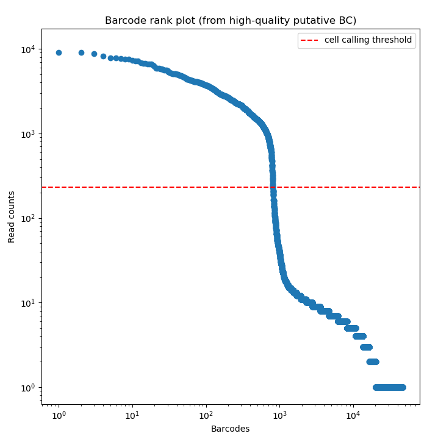

[BLAZE](https://github.com/shimlab/BLAZE) enables the accurate identification of barcodes and UMIs from Nanopore reads. The files produced by BLAZE can be used to assess the quality of the barcode calling and the data.

The knee plot shows all barcodes detected in a sample, ranked from highest to lowest read count. The "cliff-and-knee" shape (similar to the image above) is indicative of good quality. Deviations from this shape can be indicative of concerns with the data, such as low barcode counts. The `*.bc_count.txt` file can be used to accompany this figure to show every barcode and its abundance in the dataset.

## Alignment

### Minimap2

<details markdown="1">
<summary>Output files</summary>

- `<sample>/cdna/`
  - `genome/bam/original/` (when `isoquant` or `lrkallisto` is a quantifier)
    - `<sample>.cdna.genome.sorted.bam`, `.bai`: The genome alignment, sorted and indexed.
  - `transcriptome/bam/original/` (when `oarfish` is a quantifier)
    - `<sample>.cdna.transcript.sorted.bam`, `.bai`: The transcriptome alignment, sorted and indexed.
- `references/` (unless `--skip_save_minimap2_index`)
  - `genome/minimap_index/*.mmi`: The minimap2 index of the genome FASTA used for cDNA genome alignment (`-x splice -k<kmer_size>`).
  - `transcriptome/minimap_index/*.mmi`: The minimap2 index of the transcriptome FASTA used for cDNA transcriptome alignment (`-x map-ont -k<kmer_size>`).
- `references/transcriptome/transcripts.fasta` (when `oarfish` is a quantifier and `--transcript_fasta` is not given): The transcriptome the oarfish arm aligns to, extracted from the genome and GTF by `gffread -w`. Published regardless of `--skip_save_minimap2_index`.
  - `dna/minimap_index/*.mmi`: The minimap2 index of the genome FASTA used for DNA alignment (`-x map-ont`).

</details>

[Minimap2](https://github.com/lh3/minimap2) is a versatile sequence alignment program that aligns DNA or mRNA sequences against a large reference database. Minimap2 is optimized for large, noisy reads making it a staple for alignment of nanopore reads.

The cDNA genome alignment is produced whenever `isoquant` or `lrkallisto` is requested; the transcriptome alignment only when `oarfish` is. The DNA alignment is described under [DNA duplicate marking](#dna-duplicate-marking), because the published DNA BAM is the duplicate-marked one.

The pipeline builds a minimap2 index once per reference and aligns every sample against it. Only the arms that run produce an index. The k-mer and window sizes are stored in the `.mmi` and override those of whichever alignment preset later loads it, so a saved index is only equivalent to the pipeline's alignment when it is used with the same preset and `--kmer_size`.

## Alignment post-processing

### Samtools: cDNA

_cDNA only._

<details markdown="1">
<summary>Output files</summary>

- `<sample>/cdna/genome/`
  - `bam/mapped_only/`
    - `<sample>.cdna.genome_mapped_only.sorted.bam`, `.bai`: The genome alignment with unmapped reads removed. This is the BAM that is deduplicated, and the final genome BAM with `--skip_cdna_dedup`.
  - `qc/samtools/`
    - `minimap/<sample>.cdna.genome.minimap.{flagstat,idxstats,stats}`: `samtools flagstat`, `idxstats` and `stats` of the alignment as minimap2 wrote it.
    - `mapped_only/<sample>.cdna.genome.mapped_only.{flagstat,idxstats,stats}`: The same for the mapped-only BAM.
    - `dedup/<sample>.cdna.genome.umitools_dedup.{flagstat,idxstats,stats}`: The same for the deduplicated BAM. Not produced with `--skip_cdna_dedup`.
- `<sample>/cdna/transcriptome/`
  - `bam/mapped_only/`
    - `<sample>.cdna.transcript_mapped_only.sorted.bam`, `.bai`: The transcriptome alignment with unmapped reads removed.
  - `qc/samtools/`
    - `minimap/<sample>.cdna.transcriptome.minimap.{flagstat,idxstats,stats}`
    - `mapped_only/<sample>.cdna.transcriptome.mapped_only.{flagstat,idxstats,stats}`
    - `dedup/<sample>.cdna.transcriptome.umitools_dedup.{flagstat,idxstats,stats}`

</details>

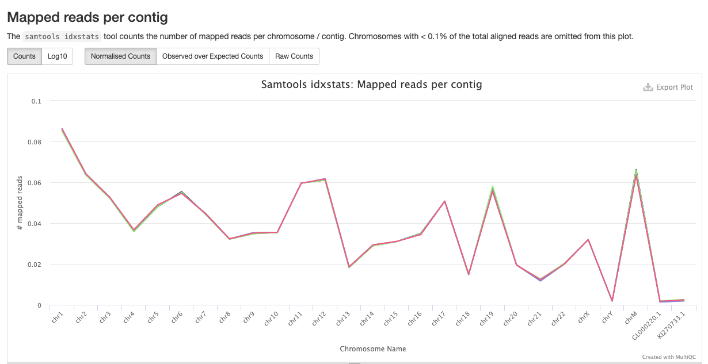
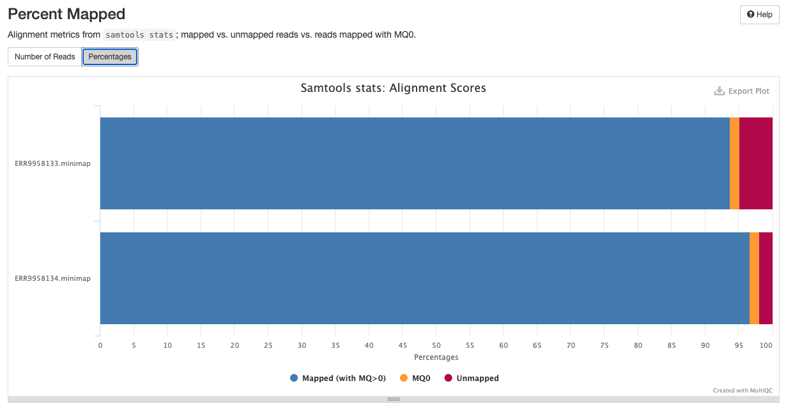

[Samtools](https://www.htslib.org/) is a suite of programs for reading, writing, editing, indexing, and viewing files that are in SAM, BAM, or CRAM format. The statistics files are not produced with `--skip_qc`.

### Samtools: DNA

_DNA only._

<details markdown="1">
<summary>Output files</summary>

- `<sample>/dna/qc/samtools/corrected/`
  - `<sample>.dna.flagstat`, `<sample>.dna.idxstats`, `<sample>.dna.stats`: `samtools flagstat`, `idxstats` and `stats` of the final DNA BAM (`bam/dedup/<sample>.bam`, or `bam/mapped_only/<sample>.bam` with `--skip_dedup`). Duplicates are flagged rather than removed, so they are included in the counts and reported as duplicates by `flagstat`.

</details>

These are not produced with `--skip_qc`.

### Barcode tags (flexiplex)

_Flexiplex only._

No separate tagging step is needed on the flexiplex path. Flexiplex writes the barcode and UMI into the FASTQ header comment, and the pipeline runs `minimap2 -y`, which copies that comment onto every alignment. The tags are:

```
CB   corrected cell barcode, or "-" when no known barcode matched
CR   cell barcode as observed in the read
UB   corrected UMI
UR   UMI as observed in the read
XB   CB when a barcode was called, otherwise CR
```

DNA libraries carry no UMI, so DNA alignments have no `UB`/`UR`.

`XB` is derived by the pipeline rather than written by flexiplex. It is what deduplication and the all-droplet quantification group on, so that a droplet which fell below the knee (a real barcode, just not on the known list) stays distinct instead of pooling with every other unassigned read under `CB:Z:-`.

Since flexiplex is run with `-a true` it reports every read, not only the ones it could match to the known barcode list, which is what makes `CR`, and therefore the uncalled droplets, available at all. Reads where flexiplex found no barcode region whatsoever are dropped during assignment: they belong to no droplet, called or empty, and carry a one-character UMI placeholder rather than a real UMI. Every alignment downstream therefore has a real `CR`, a real `XB` and a full-width UMI. Barcodes are corrected during the flexiplex run itself and are not post-corrected.

### Barcode tagging (BLAZE)

_cDNA only, BLAZE only._

<details markdown="1">
<summary>Output files</summary>

- `<sample>/cdna/`
  - `genome/bam/barcode_tagged/`
    - `*.tagged.bam`, `*.tagged.bam.bai`: The genome alignment with the barcode and UMI tags added, and its index.
  - `transcriptome/bam/barcode_tagged/`
    - `*.tagged.bam`, `*.tagged.bam.bai`: The transcriptome alignment with the barcode and UMI tags added, and its index.

</details>

Barcode tagging is a custom script (`bin/tag_barcodes.py`) which adds commonly used single-cell tags to the BAM files, which can be useful for custom downstream analysis (e.g. subsetting BAMs by cell barcode). Specifically the following tags are added:

```
barcode tag = "CR"
barcode quality tag = "CY"
corrected barcode tag = "CB"
UMI tag = "UR"
UMI quality tag = "UY"
```

Barcodes are corrected against the whitelist with the custom script `bin/correct_barcodes.py` before tagging.

### Gene assignment

_cDNA only. Produced when `--dedup_per_gene` is enabled (the default) and the genome alignment is deduplicated (i.e. not with `--skip_cdna_dedup`)._

<details markdown="1">
<summary>Output files</summary>

- `<sample>/cdna/genome/qc/gene_assignment/`
  - `<sample>.cdna.genome.gene_assignment.tsv`: The distribution of gene assignment statuses (`GS`), per contig.

</details>

When `--dedup_per_gene` is enabled, every genome alignment is tagged with the gene whose body it overlaps most before deduplication:

```
gene id tag     = "GX"
gene name tag   = "GN"
gene status tag = "GS"    # unique | ambiguous | none
```

Assignment is by gene-body overlap and is strand-agnostic. `GX` always holds the winning gene, even when a second gene also covers a meaningful share of the read, in which case `GS` is `ambiguous`. Only `unique` alignments are grouped by gene; the rest are deduplicated by position and merged back, so the `GS` distribution in the summary tsv is the ceiling on what gene grouping can act on.

### UMI-tools dedup

_cDNA only._

<details markdown="1">
<summary>Output files</summary>

- `<sample>/cdna/genome/` (not with `--skip_cdna_dedup`)
  - `bam/dedup/`
    - `<sample>.cdna.genome.dedup.bam`, `.bai`: The genome alignment after UMI deduplication. This is the BAM IsoQuant quantifies.
  - `qc/umitools/dedup/`
    - `<sample>.cdna.genome.umi_dedup_summary.tsv`: Sample-level deduplication summary (input reads, output reads, duplicate reads, duplication rate, number of dedup runs summed).
- `<sample>/cdna/transcriptome/`
  - `bam/dedup/`
    - `<sample>.cdna.transcriptome.dedup.bam`, `.bai`: The transcriptome alignment after UMI deduplication. This is the BAM oarfish quantifies.
  - `qc/umitools/dedup/`
    - `<sample>.cdna.transcriptome.umi_dedup_summary.tsv`: As above, for the transcriptome alignment.

</details>

[UMI-tools](https://umi-tools.readthedocs.io/en/latest/reference/dedup.html) deduplicates reads based on the mapping coordinate and the UMI attached to the read. The identification of duplicate reads is performed in an error-aware manner by building networks of related UMIs. It is the only cDNA deduplication tool (`--dedup_tool umitools`). By default reads are grouped by gene on the genome alignment (`--dedup_per_gene`) and by transcript on the transcriptome alignment (`--dedup_per_contig`) rather than by position; see the [usage documentation](usage.md#deduplication) for why.

Deduplication is run in parallel on one chunk per chromosome (genome alignment) or per transcript group (transcriptome alignment), and with `--dedup_per_gene` each genome chunk is additionally split into a gene-grouped and a positional run. The per-chunk `umi_tools dedup` logs therefore only hold chunk-level counts and are not published. Instead their `Input Reads` and `Number of reads out` figures are summed into the `*.umi_dedup_summary.tsv` file, which is also shown as the "UMI-tools Deduplication" table in the MultiQC report. The `duplication_rate` column is `duplicate_reads / input_reads`.

`oarfish` requires deduplicated input, so the transcriptome alignment is always deduplicated. Deduplication of the genome alignment (used by IsoQuant) is performed by default and can be turned off with `--skip_cdna_dedup`, in which case no `bam/dedup/`, `qc/samtools/dedup/` or `qc/umitools/` output is published for the genome alignment, and the mapped-only BAM under `bam/mapped_only/` is the final genome BAM. `--skip_dedup` only governs duplicate marking on the DNA arm and has no effect on cDNA deduplication.

### DNA duplicate marking

_DNA only._

<details markdown="1">
<summary>Output files</summary>

- `<sample>/dna/`
  - `bam/dedup/`
    - `<sample>.bam`: The DNA alignment with duplicates flagged (`0x400`), not removed. The duplicate marker writes it coordinate-sorted and it is published as is.
    - `<sample>.bam.bai`: Its index, from `samtools index`.
  - `bam/mapped_only/` (only with `--skip_dedup`)
    - `<sample>.bam`, `<sample>.bam.bai`: The sorted minimap2 alignment and its index instead. Despite the directory name, this BAM is not filtered and still contains the unmapped reads.
  - `qc/dedup/` (not with `--skip_dedup`)
    - `<sample>.dna.dedup.metrics.txt`: Duplication metrics in Picard's `DuplicationMetrics` format (written by the pipeline's own script, not by Picard), summarised in the MultiQC report.
    - `<sample>.dna.dedup.dedup_summary.tsv`: Molecules, duplicates and duplicate sets, the duplicate rate without the exact-only contigs (`nuclear_duplicate_rate`), the duplicates each rule added, secondary/supplementary records flagged, and the 3' adapter classes seen. `no_barcode` counts primary reads without a cell barcode tag; they are left unflagged and are not counted in `primary_reads` (inside the pipeline every DNA read has one, so it is 0).

</details>

DNA samples (Tn5 tagmentation, no UMI) are deduplicated by `bin/mark_dna_duplicates.py`. Within one barcode (`XB`), two primary alignments are one molecule when they share the 5' unclipped anchor and strand (Picard's key), when their 5' anchors are within 10 bp and the far ends within 20 bp of reads that read through into the far adapter, when they are two records of one raw read (flexiplex writes a read out once per barcode it finds, so a read with the barcode pattern at both ends appears twice, on opposite strands), or when one is an A-A fragment read from the other end. One read per molecule stays unflagged, and the duplicate flag is propagated to the secondary and supplementary alignments of every duplicate, so `samtools view -F 0x400` alone gives a deduplicated BAM. Members of a duplicate set carry `DS` (set size) and `DI` (set index, unique across the BAM).

On the contigs listed in `--dna_exact_only_contigs` (default `chrM,MT`, the mitochondrial genome under both common names; matched exactly) only the exact relations apply: the shared 5' anchor and strand, and the two records of one raw read. Mitochondrial coverage is dense enough that the 10/20 bp tolerances merge distinct molecules by chance (on one library they took the chrM duplicate rate from 42% to 63%), and mtDNA has no heterozygous sites to check them against. If your reference names the mitochondrial genome differently, add its name to `--dna_exact_only_contigs`; the pipeline logs a warning when none of the listed contigs is in the reference. Because these contigs can hold a large share of the reads, the summary also reports the duplicate rate on all other contigs as `nuclear_duplicate_rate` (and the reads and duplicates on the listed contigs as `exact_only_contigs_primary_reads` and `exact_only_contigs_duplicates`); the Picard-format metrics, and so the MultiQC Picard section, keep the whole-genome rate.

These rules were chosen against a heterozygous-SNP ground truth: reads of one molecule share an allele at every het site they both cover. On three libraries, 5'-identical reads remain one molecule even when their far ends are more than 1 kb apart, 1-10 bp of 5' jitter is at most 4% distinct molecules while 11-20 bp is 12-52%, and the two records of one raw read are always the same molecule.

## Feature-barcode quantification

_cDNA only._ Which of these directories exist depends on `--quantifier`.

### IsoQuant

<details markdown="1">
<summary>Output files</summary>

- `<sample>/cdna/genome/`
  - `isoquant/<sample>.cdna/<sample>.cdna/`
    - `<sample>.cdna.gene_grouped_tag_CB_counts.{matrix.mtx,barcodes.tsv,features.tsv}`: The gene-level feature-barcode matrix of the called cells in Matrix Market format (genes × cells), readable with `Seurat::ReadMtx()` or `scanpy.read_mtx()`.
    - `<sample>.cdna.transcript_grouped_tag_CB_counts.{matrix.mtx,barcodes.tsv,features.tsv}`: The same for transcripts.
  - `isoquant_all_droplets/<sample>.cdna.all_droplets/<sample>.cdna.all_droplets/` (flexiplex only)
    - `<sample>.cdna.all_droplets.gene_grouped_tag_XB_counts.{matrix.mtx,barcodes.tsv,features.tsv}`: As above, over every droplet rather than the called cells.
    - `<sample>.cdna.all_droplets.transcript_grouped_tag_XB_counts.{matrix.mtx,barcodes.tsv,features.tsv}`: As above, over every droplet rather than the called cells.

</details>

[IsoQuant](https://github.com/ablab/IsoQuant) is a tool for the genome-based analysis of long RNA reads, such as PacBio or Oxford Nanopores. IsoQuant allows to reconstruct and quantify transcript models with high precision and decent recall. If the reference annotation is given, IsoQuant also assigns reads to the annotated isoforms based on their intron and exon structure. IsoQuant further performs annotated gene, isoform, exon and intron quantification. The outputs of IsoQuant can be important for downstream analysis with tools specialized in single-cell/nuclei analysis (e.g. `Seurat`).

IsoQuant quantifies the **genome** alignment (the deduplicated BAM, or the mapped-only BAM with `--skip_cdna_dedup`) and produces both gene- and transcript-level matrices. It runs once per sample on the whole BAM. Whether intronic and inconsistent reads are counted is set by `--retain_introns` (see the [usage documentation](usage.md#analysis-options)).

When demultiplexing with flexiplex, IsoQuant is run twice off the same alignments:

- `isoquant/` groups on `CB`, so it covers the cells flexiplex matched to the known barcode list. This is the matrix to use for ordinary analysis, and the one Seurat QC is run against. IsoQuant puts the reads that matched no known barcode in a single `-` column; `drop_barcode.py` removes that column (and its entry in the barcode list) before the matrices are published or reach Seurat QC, so the published matrices hold the called cells only.
- `isoquant_all_droplets/` groups on `XB`, which falls back to the uncorrected barcode. Droplets below the knee called by `flexiplex-filter` therefore appear here under their own barcode alongside the called cells, which is what makes ambient/empty-droplet estimation possible. It has no `-` column: reads with no barcode region at all were dropped during assignment.

With BLAZE only `isoquant/` is produced.

### oarfish

<details markdown="1">
<summary>Output files</summary>

- `<sample>/cdna/transcriptome/oarfish/`
  - `<sample>.barcodes.tsv.gz`, `<sample>.features.tsv.gz`, `<sample>.matrix.mtx.gz`: The transcript-level feature-barcode matrix of the called cells, in Matrix Market format.
  - `<sample>.meta_info.json`: oarfish's run information and the parameters it was run with.

</details>

[oarfish](https://github.com/COMBINE-lab/oarfish) is a program, written in [Rust](https://www.rust-lang.org/), for quantifying transcript-level expression from long-read (i.e. Oxford nanopore cDNA and direct RNA and PacBio) sequencing technologies. oarfish requires a sample of sequencing reads aligned to the transcriptome (currently not to the genome). It handles multi-mapping reads through the use of probabilistic allocation via an expectation-maximization (EM) algorithm. It is run with `--single-cell --model-coverage --filter-group no-filters`.

oarfish quantifies the deduplicated **transcriptome** alignment and produces transcript-level matrices only. It is recommended to keep `--save_transcript_secondary_alignment` enabled (the default) for the most accurate oarfish results. This can lead to a much higher number of reads reported as aligned; that is expected when secondary alignments are included.

oarfish groups on `CB`, but reads whose `CB` is `-` are removed before it runs, so its transcript matrix holds the called cells only and has no `-` column.

### lr-kallisto

_flexiplex only._

<details markdown="1">
<summary>Output files</summary>

- `references/lrkallisto/`
  - `kallisto.idx`: The k=63 kallisto index.
  - `*.t2g.tsv`: The transcript-to-gene mapping.
  - `transcripts.fasta`: The transcript sequences extracted from the genome and GTF by `gffread`.
- `<sample>/cdna/lrkallisto/`
  - `gene/`: Gene-level UMI count matrix (`barcodes.tsv.gz`, `features.tsv.gz`, `matrix.mtx.gz`) from `bustools count --genecounts`. Integer counts; a UMI compatible with more than one gene is discarded rather than split.
  - `transcript/`: Transcript-level abundance matrix (`barcodes.tsv.gz`, `features.tsv.gz`, `matrix.mtx.gz`) from the `kallisto quant-tcc` EM. Estimated abundances, not integer counts.
  - `quant/`: The raw `kallisto quant-tcc` output:
    - `matrix.abundance.mtx`: The EM transcript abundances.
    - `matrix.abundance.tpm.mtx`: The same, TPM-normalised.
    - `matrix.abundance.gene.mtx`: The EM abundances aggregated to genes. This distributes gene-ambiguous UMIs instead of discarding them.
    - `matrix.abundance.gene.tpm.mtx`: The same, TPM-normalised.
    - `transcripts.txt`, `genes.txt`: The row names of the transcript and gene matrices.
  - `counts_unfiltered/`: The transcript compatibility count (TCC) matrix and its equivalence classes (`cells_x_tcc.mtx`, `cells_x_tcc.barcodes.txt`, `cells_x_tcc.ec.txt`).
  - `bus/`: The BUS file (`output.bus`), equivalence class map (`matrix.ec`), transcript names (`transcripts.txt`) and `run_info.json` pseudoalignment statistics.
  - `qc/seurat/`: Seurat QC of the `gene/` and `transcript/` matrices (see [Seurat](#seurat)).
- `<sample>/cdna/lrkallisto_all_droplets/` (unless `--skip_lrkallisto_all_droplets`)
  - `gene/`, `transcript/`, `quant/`, `counts_unfiltered/`, `bus/`: The same five outputs, over every droplet rather than the called cells. There is no Seurat QC for this pass.

</details>

[lr-kallisto](https://kallisto.readthedocs.io/en/latest/lr/pseudoalignment.html) is the long-read mode of [kallisto](https://github.com/pachterlab/kallisto). Rather than aligning reads, it pseudoaligns them against an index built with a longer k-mer than short-read kallisto uses (63 rather than 31), then quantifies transcript abundances with an expectation-maximization algorithm adapted to long-read error profiles. The quantifier itself consumes no alignment, but the cDNA genome alignment is still produced whenever `lrkallisto` is requested, so the BAMs and alignment-derived QC under `<sample>/cdna/genome/` are present here too.

lr-kallisto is run twice off the same reads and the same index, mirroring the two IsoQuant passes described above. It reads the barcode out of the flexiplex read, so this quantifier requires `--demux_tool_cdna flexiplex`:

- `lrkallisto/` takes the barcode from the flexiplex read name, which is the one matched to the known barcode list, and `bustools correct` then drops the reads that matched nothing. This is the matrix to use for ordinary analysis, and the one Seurat QC is run against.
- `lrkallisto_all_droplets/` takes the barcode from the `XB` tag, which falls back to the uncorrected barcode. Droplets below the knee called by `flexiplex-filter` therefore appear here under their own barcode alongside the called cells, which is what makes ambient/empty-droplet estimation possible. Barcodes are not corrected in this pass: `XB` is already the final droplet identity, and correcting would discard the very droplets the matrix exists to keep.

  Because they are not corrected, sequencing errors in the below-knee barcodes would otherwise inflate the column count without bound: on a full sample that is millions of near-singleton barcodes against a few thousand real cells, and the cost of the EM scales with it. `--lrkallisto_all_min_reads` (default `100`) puts a floor under this, keeping only barcodes flexiplex saw at least that many times. On a full 10x Multiome sample that reduces the matrix from ~14.1M columns to ~233k while retaining ~54% of the below-knee reads; called cells sit far above the threshold and are unaffected. Set it to `0` to keep every barcode, or use `--skip_lrkallisto_all_droplets` to skip the pass altogether.

Barcodes and UMIs are taken from the flexiplex read names and written into a synthetic barcode read, so that kallisto can locate them positionally. UMI deduplication is performed by `bustools` during counting rather than by UMI-tools, so `--skip_cdna_dedup`, `--dedup_tool` and `--skip_dedup` do not apply to the lr-kallisto matrices.

Both gene and transcript matrices come from a single pseudoalignment pass, but they are counted differently. `kallisto bus --long` writes the BUS file, `bustools` sorts it and, in the `lrkallisto/` pass, corrects barcodes against the flexiplex known-barcode list. The sorted BUS file is then counted twice, and each count collapses UMIs per gene (`--umi-gene`) as it goes:

- `gene/` is `bustools count --genecounts`, the standard kb-python gene matrix. Every entry is a whole UMI. A UMI whose equivalence class is compatible with more than one gene is discarded rather than split, so the matrix is a genuine count matrix and is the one to use with Seurat, scran, DESeq2 or any other tool that assumes integer counts. On the chr21 `test_lrkallisto` data that discards 28% of UMIs, which is a worst case for a reference that small; expect much less on a whole transcriptome, but check it on your own data by comparing the grand total of `gene/matrix.mtx.gz` with that of `quant/matrix.abundance.gene.mtx` (the two are stored in opposite orientations, so compare totals rather than per-column sums). `gene/features.tsv.gz` carries the three Cell Ranger v3 columns (gene id, gene name, `Gene Expression`), so the directory loads as-is in Seurat, Scanpy and CellBender.
- `transcript/` is the transcript compatibility count matrix resolved into transcript abundances by `kallisto quant-tcc --long`. The EM distributes each UMI across the transcripts it is compatible with, so the entries are fractional estimates rather than counts. The same EM aggregated to genes is in `quant/matrix.abundance.gene.mtx`; it keeps the gene-ambiguous UMIs that `gene/` drops, and it is fractional for the same reason, so `gene/` and the per-gene sum of `transcript/` do not agree.

Ambient RNA and empty-droplet tools such as CellBender fit a count likelihood and cannot use the EM output. Give them `lrkallisto_all_droplets/gene/`.

`bus/run_info.json` is worth checking after a run: a low `p_pseudoaligned` usually indicates a barcode geometry or strandedness mismatch rather than poor data.

### Seurat

<details markdown="1">
<summary>Output files</summary>

- `<sample>/cdna/`
  - `genome/qc/seurat_isoquant/`
    - `gene/`
      - `<sample>.csv`: Statistics of the cell-read distribution of the IsoQuant gene matrix.
      - `<sample>.png`: QC plots of the IsoQuant gene matrix.
      - `<sample>_seurat.rds`: The Seurat object built from the gene matrix, ready to load with `readRDS()`.
    - `transcript/`
      - `<sample>.csv`, `<sample>.png`, `<sample>_seurat.rds`: The same for the IsoQuant transcript matrix.
  - `transcriptome/qc/seurat_oarfish/`
    - `<sample>.csv`, `<sample>.png`, `<sample>_seurat.rds`: The same for the oarfish transcript matrix.
  - `lrkallisto/qc/seurat/`
    - `gene/`, `transcript/`: The same for the lr-kallisto gene and transcript matrices.

</details>

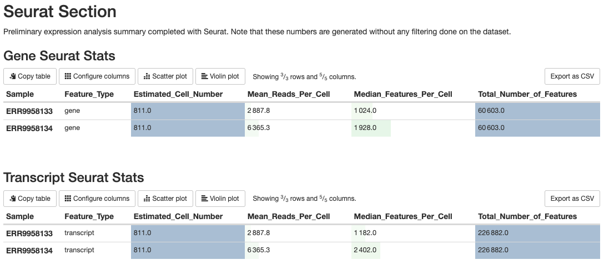

[Seurat](https://satijalab.org/seurat/) is an R package designed for QC, analysis, and exploration of single-cell RNA-seq data. The pipeline runs it on the called-cell matrices only (not on the all-droplet matrices). The statistics of the IsoQuant gene and transcript matrices and of the oarfish transcript matrix are also collected in the MultiQC report, one section each; the lr-kallisto statistics are only published here. Seurat QC is not run with `--skip_seurat` or `--skip_qc`.

## Summary QC

### RSeQC

_cDNA only._

<details markdown="1">
<summary>Output files</summary>

- `<sample>/cdna/genome/qc/rseqc/`
  - `<sample>.read_distribution.txt`: How the reads of the genome alignment are distributed over gene features (exons, introns, UTRs, intergenic regions).

</details>

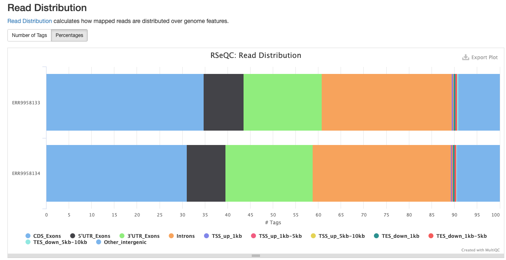

The [RSeQC](https://rseqc.sourceforge.net/) package provides a number of useful modules that can comprehensively evaluate high throughput sequence data, especially RNA-seq data. The pipeline runs `read_distribution.py` on the cDNA genome alignment, against a BED file it derives from the GTF. RSeQC is not run on the transcriptome alignment, and not with `--skip_rseqc` or `--skip_qc`.

### Read counts

<details markdown="1">
<summary>Output files</summary>

- `batch_qcs/read_counts/`
  - `read_counts.csv`: The number of reads each sample has at successive points in the pipeline. Each row is a sample, and each column the number of reads at one step.

</details>

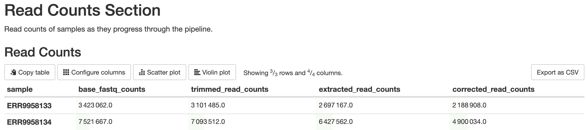

Since flexiplex is run with `-a true` it passes through every read in which it found a barcode region, whether or not that barcode matched the known list. `extracted_read_counts` therefore does not drop to the reads that were given a known barcode; it is `trimmed_read_counts` minus the reads with no barcode region at all, which are discarded during assignment. Read the barcode-calling rate from `corrected_read_counts`, which counts only reads assigned a known barcode.

This is a custom script (`bin/generate_read_counts.sh`). Its purpose is to report the number of reads that are filtered out at steps in the pipeline that remove reads, such as trimming, barcode detection and barcode correction. Elevated levels of filtering can be indicative of quality concerns.

For performance, this step parses the read counts from the output of either FastQC or NanoPlot rather than computing them, so it needs one of the two (NanoPlot runs by default). It is not produced with `--skip_qc`.

### MultiQC

<details markdown="1">
<summary>Output files</summary>

- `batch_qcs/multiqc/`
  - `final_qc/`: The report on the processed data.
    - `multiqc_report.html`: A standalone HTML file that can be viewed in your web browser.
    - `multiqc_data/`: Directory containing parsed statistics from the different tools used in the pipeline.
    - `multiqc_plots/`: Directory containing static images from the report in various formats (`pdf/`, `png/`, `svg/`).
  - `raw_qc/`: The same three outputs, for a report on the raw reads only.

</details>

[MultiQC](http://multiqc.info) is a visualization tool that generates a single HTML report summarising all samples in your project. Most of the pipeline QC results are visualised in the report and further statistics are available in the report data directory. Neither report is produced with `--skip_multiqc` or `--skip_qc`.

The pipeline writes two reports:

- `raw_qc/` summarises the raw reads, before trimming: the pre-trim FastQC results, NanoPlot statistics and FASTQ NanoComp statistics. It is only produced when all three of these tools run, and FastQC and FASTQ NanoComp are off by default, so a default run has no `raw_qc/` report.
- `final_qc/` is the main report. Its sections depend on the data types and quantifiers in the run, and include the read counts table; samtools `flagstat`/`idxstats` of the cDNA alignments and `flagstat` of the DNA alignment; RSeQC read distribution; the UMI-tools deduplication summary; the DNA duplicate-marking metrics (Picard-format duplication metrics); the Seurat statistics of the IsoQuant gene and transcript and oarfish transcript matrices; the post-trim and post-extract FastQC results when FastQC is enabled; the BAM NanoComp statistics when enabled; and the software versions and run parameters.

For more information about how to use MultiQC reports, see <http://multiqc.info>.

## Pipeline information

<details markdown="1">
<summary>Output files</summary>

- `pipeline_info/`
  - Reports generated by Nextflow: `execution_report_<timestamp>.html`, `execution_timeline_<timestamp>.html`, `execution_trace_<timestamp>.txt` and `pipeline_dag_<timestamp>.html`. `<timestamp>` is the run's start time (`--trace_report_suffix`).
  - `lrsinglecell_software_mqc_versions.yml`: The version of every tool used in the run, also shown in the MultiQC report.
  - `params_<timestamp>.json`: The parameters used by the run.
  - `pipeline_report.html` and `pipeline_report.txt`: Run summary, only present if `--email` or `--email_on_fail` is used.

</details>

[Nextflow](https://docs.seqera.io/platform-cloud/reports/overview) provides excellent functionality for generating various reports relevant to the running and execution of the pipeline. This will allow you to troubleshoot errors with the running of the pipeline, and also provide you with other information such as launch commands, run times and resource usage. The execution trace is the place to look up the memory (`peak_rss`) and run time of each task when tuning resources.

## Intermediate files that are not published

Several steps write files that are only used inside the pipeline and are not copied to the results directory. In particular:

- The decompressed and indexed references (`--genome_fasta`, `--transcript_fasta`, `--gtf`).
- The UCSC `genePred` and BED conversions of the GTF (`ucsc-gtftogenepred`, `ucsc-genepredtobed`), which only serve as the RSeQC annotation.
- The duplex-filtered (`--drop_duplex_parents`), trimmed, demultiplexed and split FASTQs, and the BLAZE per-read barcode corrections.
- The per-chunk BAMs and `umi_tools dedup` logs of the deduplication step.
- The FASTQs with the synthetic barcode read given to `kallisto bus`, and the barcode-sorted BAM given to oarfish.

They remain in the Nextflow work directory until it is cleaned.
